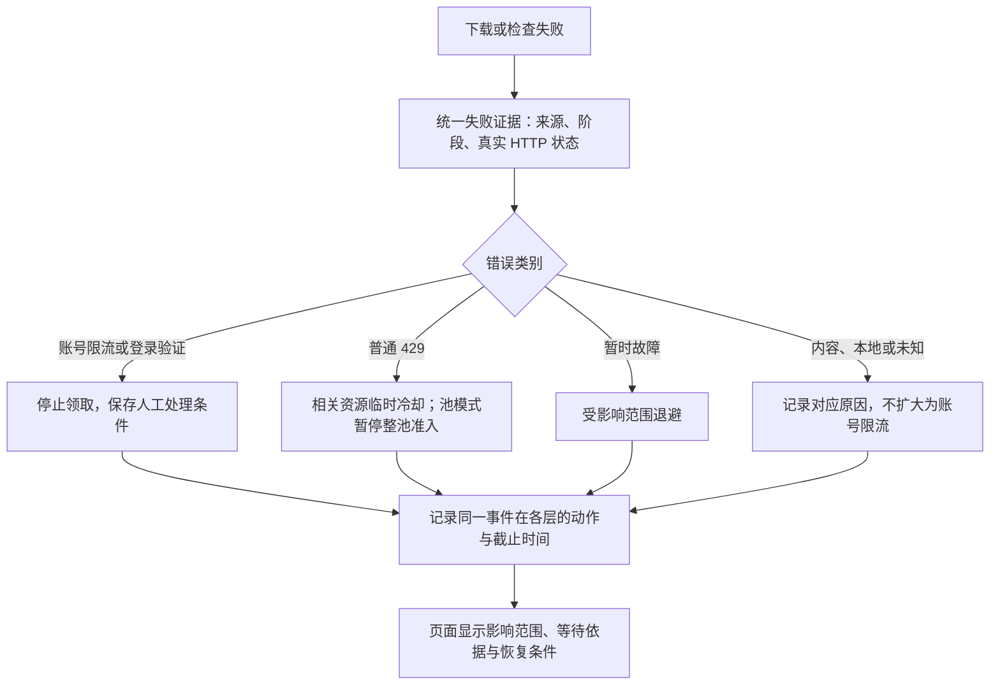

# 下载错误、恢复规则与页面依据

`webapp/download_policy.py` 统一生成失败证据和恢复策略，渠道调度、YouTube 请求节奏、Cookie 池与字幕队列使用同一分类。任务进度及结构化日志保留同一个事件编号，页面读取已记录事实，不探测源站或补造历史响应。

## 错误证据

每条证据包含事件编号、观察时间、来源、阶段、错误类别、HTTP 状态、证据类型、Retry-After、能否自动重试和脱敏摘要。账号限流是错误类别，不能写成未经观测的 HTTP 429；账号提示可能出现在 HTTP 200 响应内。

HTTP 异常对象的状态与错误文本里的 HTTP 状态分别标记。仅在文本明确写出 HTTP 状态时解析，URL 中的数字不参与判断。异常链遵守 `raise ... from None`，本地资源等待及历史池停止优先识别为本地原因。

| 证据类别 | 恢复动作 | 影响范围 |
| --- | --- | --- |
| 明确账号限流 | 至少一小时冷却，停止实例领取，人工检查恢复；渐进模式保留重复事件退避 | 当前池、当前会话、相关共享资源及请求节奏 |
| 不可重试的登录检查失败 / 额外验证 | 停止领取并人工处理；池保留停止状态 | 当前实例与池，不将其认定为普通网络限流 |
| 普通 HTTP 429 | 临时冷却，遵守 Retry-After；YouTube 默认至少使用配置的 300 秒，其他渠道默认 30 秒 | 相关共享资源；池模式同时临时停止整个池准入，避免换会话继续请求 |
| 暂时性网络 / 服务故障 | 至少 60 秒退避，保留更晚的既有截止时间 | 受影响会话、启用的渐进请求节奏；503 同时影响相关共享资源 |
| 明确的视频权限 / 格式限制 | 不据此降低其他账号容量或共享健康 | 当前视频 |
| 普通 401 / 403、未知错误 | 保留证据，不直接断言账号限流 | 渠道健康仍可按连续失败规则暂时退避，但不因此生成账号限流或整池人工停止 |
| 本地资源等待、历史停止状态 | 不生成新的源站限流事件 | 本地准入条件 |

这些是本地运行策略，不是 YouTube 公布的风控阈值。会话观察期及并发放量规则不因本次修改而改变，也不意味着通过观察期就获得了安全额度。

## 多层决策

同一次失败在各层共用事件编号及冷却基准时间，截止时间取较晚者，不把冷却秒数相加。不同阶段和渠道仍按各自许可检查；某个解析组冷却不等于所有正在传输的视频必须中止。晚到的成功不能清除尚未结束的冷却，会话也不能因旧任务成功而提前完成观察期。

资源状态各保留最多 8 条决策，页面聚合最近最多 8 个事件。同次事件合并展示各层影响，保留摘要而非 Cookie、响应正文或带签名的完整地址。批量读取多实例诊断时，本地停止和节奏状态按实例过滤，共享资源仍按配置共享。

## 页面和恢复

工作台及实例页的「并发与等待」展示当前限制、影响范围、倒计时、人工恢复条件及最近触发记录；任务详情展示本次已保存的结构化错误证据。离线或过期采样显示为上次记录，倒计时到零只提示等待新状态，不承诺源站恢复。

人工停止状态不会因冷却到期自动解除。池需要停止实例、等待任务结束、冷却到期、重新检测全部成员并解除拦截，再手动恢复。实例恢复会清除该实例执行停止标记，但保留事件历史，不会清除池及共享资源限制。

旧版保留下来的池停止标志（包括当时由 HTTP 429 产生的标志）继续要求人工检查；缺少具体响应证据时明确标为历史记录，不自动归类为新的账号限流。

## 验证

`python -m unittest tests.test_download_policy tests.test_download_decisions tests.test_cookie_pool tests.test_youtube_pacing tests.test_youtube_policy tests.test_channel_scheduler tests.test_concurrency_diagnostics tests.test_risk_diagnostics`

场景覆盖真实 HTTP 与账号提示分离、异常链、敏感数据脱敏、跨层事件与截止时间一致、普通 429 到期准入、旧停止重放、迟到成功、实例恢复、多实例隔离及 Node 页面渲染。
