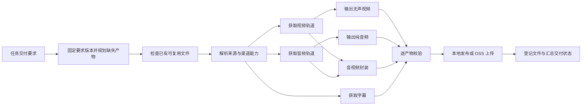

# 多种交付内容：代码与页面设计

实施说明：该设计已完成首版实现，实际数据结构、API、恢复语义、兼容范围及验证结果以 [实现与使用](multi-output-delivery.md) 为准。实现复用现有正式/测试账本作为交付凭据，新增五张表；计划逻辑合入执行器，保持现有队列基础设施。下面保留原设计供对照。

状态：设计稿，2026-11-13。配套交互原型：[delivery-prototype.html](design/delivery-prototype.html)。原型使用演示数据。

## 1. 客户任务决定交付内容

新建客户任务时多选以下内容，至少选择一项，共支持 15 种非空组合。

| 页面名称 | 代码类型 | 交付文件 | 完成校验 |
|---|---|---|---|
| 字幕 | `subtitle` | 按语言独立保存 SRT / VTT | 可解析、有有效字幕条目、语言及来源有记录 |
| 无声视频 | `video_only` | 只有画面的视频文件 | 存在视频流，没有音频流 |
| 纯音频 | `audio_only` | M4A / WebM，或明确选择 MP3 | 存在音频流，没有视频流 |
| 音视频成品 | `av` | 带声音的 MP4 / MKV | 同时存在视频流和音频流，时长合理 |

“视频”容易与“带声音的成品”混淆，因此所有选择器都使用上面的完整名称。四项全选代表四类产物；字幕有多个语言时，实际文件数可能超过四个。缩略图、描述信息、临时轨道不算交付类型。

推荐新任务默认只选“音视频成品”。修改系统默认值仅影响之后创建的任务；每个任务保存自己的要求，同一个任务由不同实例处理时要求一致。

字幕第一版作为独立文件交付。内嵌字幕和烧录字幕属于后续可增加的成品选项，不混入当前四种类型。

## 2. 任务表单与配置

任务编辑页拆为“基本信息 / 交付要求 / 来源清单”三个区块；屏幕宽时右侧固定展示交付摘要与文件示例。

- 基本信息：客户、任务名称、单价、备注。
- 交付要求：四张复选卡片，提供“仅成品 / 仅字幕 / 四项全选 / 自定义”快捷选择。未选择任何类型时阻止保存。
- 选中字幕后才显示语言、SRT/VTT 格式、人工/自动字幕来源、缺失处理；不主动请求全部自动翻译语言。
- 选中画面类型后显示画质上限及容器偏好；选中纯音频后显示原始音质/MP3 设置。
- 仅字幕时隐藏画质、音频码率和音视频合并设置。
- 来源清单使用现有 TXT/CSV 导入与去重，继续按来源视频 ID 组织条目。
- 摘要直接说明“每条来源交付：无声视频 + 纯音频”“最多 3 种语言字幕”，不把语言数误认为来源数。

建议请求结构（字段与实例运行参数分开）：

```json
{
  "customer": "客户 A",
  "name": "十一月素材",
  "price": "0.8",
  "delivery": {
    "schema_version": 1,
    "outputs": ["subtitle", "video_only", "audio_only", "av"],
    "video": {"max_height": 1080, "container": "source"},
    "audio": {"format": "source"},
    "av": {"container": "auto"},
    "subtitles": {
      "languages": ["en", "zh-Hans", "zh-Hant"],
      "format": "srt",
      "sources": ["manual", "automatic"],
      "language_policy": "available_selected",
      "missing_policy": "review"
    }
  }
}
```

`source` 保留合适的原始编码及容器，尽量不转码；`auto` 在编码兼容时使用 MP4，否则使用 MKV。若客户明确要求 MP4，必须按约定转码或报告不支持，不能悄悄改扩展名。MP3 是显式转码选项，不能把任意音频改名为 `.mp3`。

字幕语言策略默认“下载指定语言中实际存在的语言，至少一份”；可选择“每种所选语言都必须存在”。人工字幕优先，同一语言的自动字幕作为备选，避免默认交付重复版本。

## 3. 完成、缺失与补交

来源条目的交付状态独立于工作进程是否完成一次执行。

| 交付状态 | 含义 | 页面动作 |
|---|---|---|
| 待处理 | 还没有正式交付 | 启动 |
| 处理中 | 正在下载、处理或上传所需产物 | 查看进度、立即停止 |
| 部分交付 | 已交付部分产物，仍有未完成项 | 仅补齐缺失项 |
| 待确认缺失 | 来源没有要求的音轨、视频或字幕 | 查看原因、接受缺失、调整要求后补交 |
| 全部交付 | 所有要求已实际交付 | 下载/导出文件 |
| 已按约定结束 | 有人工接受的缺失项，其余已交付 | 查看确认记录 |

暂时的网络错误、403、429 不能判断为“源站无字幕”；只有成功解析来源后确认不存在，才能进入缺失确认。重试耗尽显示具体失败项和原因。仅字幕任务遇到无字幕来源也不得显示“成功交付字幕”。

“接受缺失”记录操作人、时间、原因和被豁免的项；豁免项交付大小为 0，不算实际交付文件。“全部交付”与“已按约定结束”在汇总中分别显示。

现有 `tasks.status` 继续描述领取、运行、重试和终止；不贸然给整个任务系统增加 `partial` 状态。新增交付状态由产物账本汇总。工作任务可以执行失败但已有有效产物，后续只补缺项；不能因主任务已结束而丢弃已交付文件。

修改交付要求采用版本管理：未开始的任务可直接修改；任务已经启动后，编辑时明确选择“仅尚未开始的来源”或“另建补交批次”。正在执行的条目继续使用已固定的版本；已完成条目不会因为编辑而自动重新下载。详情按要求版本显示，避免把同一任务不同版本的完成率混在一起。补交批次关联原条目，沿用相同要求时可复用已验证文件。

## 4. 页面调整范围

| 页面 | 调整内容 |
|---|---|
| 任务中心列表 | 新增“交付内容”标签；分别显示来源数、全部交付、部分交付、待确认；已交付文件数与大小单列 |
| 新建/编辑任务 | 多选交付类型、按需展开选项、右侧文件预览、要求版本及修改范围 |
| 任务详情 | 每条来源一行，字幕/无声视频/纯音频/音视频成品四列状态；展开文件、语言、大小、位置；筛选部分交付和缺失；补交与豁免 |
| 下载工作台 | 所选客户任务的交付摘要；阶段显示获取画面、获取音频、下载字幕、生成成品、校验、上传；显示来源进度和各产物状态 |
| 素材库 | 扩展为“交付文件”，按来源分组，按产物类型/语言/位置筛选；视频播放器、音频播放器、字幕文本预览；保留历史视频入口 |
| 交付与账单 | 分开显示来源条目、文件数量、交付大小、实际网络传输、测试大小；按类型细分与导出；显示缺失豁免 |
| 系统设置 | 客户交付要求移到任务中；设置页只提供新任务默认值及实例能力、网络、并发、资源、保存方式 |
| 下载实例 | 显示可执行的类型、FFmpeg/转码能力、兼容性；不支持当前要求时显示等待原因 |
| 执行日志 | 增加产物类型、要求版本、阶段和错误原因；限流说明指向具体产物 |
| 导入/导出 | TXT/CSV 来源导入仍沿用任务要求；导出增加类型、语言、来源/自动字幕、大小、状态、存储位置 |

客户只看到自己的交付选择和完成情况。账号 Cookie、代理、渠道等运行配置保留在实例管理中，不要求客户理解。

测试模式明确显示“测试处理，文件结束后删除，不构成客户交付”；四种产物均能测试处理与校验，记录测试产物，不把当前“测试不保留字幕”误当成不执行字幕需求。正式任务的文件交付动作在测试模式下不可用。

## 5. 下载和生成流程



- 仅字幕：跳过媒体流下载与音视频处理，保留账号/上游限流约束。
- 仅纯音频：优先获取音频流，不先下载完整高清视频再抽取。
- 仅无声视频：优先获取画面流。若提供方只能给完整成品，可复用后剥离音频，但必须满足画质要求并校验结果。
- 音视频成品 + 无声视频 + 纯音频：共享同一次获取的画面及音频轨道，再生成所选文件，避免三次下载。
- 字幕使用独立上游预算，不占用媒体传输名额；字幕失败不会删除已完成媒体产物，整体状态仍体现尚未交齐。
- 渠道按能力筛选。第一版字幕由 yt-dlp 处理；其他提供方逐一验证产物、语言、音轨、质量支持后再启用。无合适渠道应显示明确原因，不降级交付其他类型。
- 本地处理统一进入现有 `local_processing` 资源限制；`DiskBudget` 为共享原料、保留产物和临时文件估算空间，发布文件后再释放原料。
- 成功产物先发布到受控位置，再按租约及要求版本登记。停止或租约丢失的旧进程不能覆盖新结果。
- 重启、部署立即停止后，可以从持久化产物记录补交，仍须核验文件实际存在、可读且匹配要求；不能复用已删除的测试文件。

## 6. 数据与代码结构

当前必须解决的限制：

1. `webapp/statistics.py:file_identity()` 在注册实例模式下主要按任务标识去重，多产物会漏记后续文件。
2. `webapp/worker/results.py:record_completed_file()` 只接受视频后缀，音频与字幕不会进入交付账本。
3. `webapp/worker/pipeline.py` 的归档跳过逻辑只判断来源是否下载过，无法判断缺哪个产物。
4. `webapp/catalog.py` 与 `/media/videos/` 是视频专用索引及预览路由。
5. `Utils/oss_storage.py:upload_video()` 依赖视频主文件寻找配套文件，无法覆盖只有字幕的任务。
6. 字幕目前是视频完成后的附属任务，仅字幕时没有视频路径可以依赖。

建议新增模块，保持现有任务领取与限流基础设施：

| 模块 | 职责 |
|---|---|
| `webapp/delivery/contracts.py` | 要求结构、校验、规范化、版本及摘要 |
| `webapp/delivery/planner.py` | 所需产物、已交付/可复用项、共享原料、渠道能力 |
| `webapp/delivery/executor.py` | 获取、处理、恢复、子阶段编排；不另建一套工作进程 |
| `webapp/delivery/artifacts.py` | 文件登记、租约防护、幂等与交付状态汇总 |
| `webapp/delivery/verify.py` | FFprobe 媒体流及字幕内容校验 |
| `webapp/delivery/routes.py` | 产物查询、预览、下载、补交、缺失确认 |
| `webapp/delivery/storage.py` | 按显式产物清单发布至本地或 OSS |
| `static/delivery_options.js` + 模板组件 | 任务表单与默认设置共用四项选择器 |

现有接入点：`webapp/jobs.py`、`repositories/queue_control.py` 负责选用交付要求；`downloader.py`、`adapters/execution.py`、`worker/pipeline.py` 负责计划执行；`worker/results.py`、`statistics.py`、`lists.py`、`billing.py` 接入逐产物登记；`subtitles.py` 改为不依赖视频路径的产物阶段；`catalog.py` 与媒体服务扩展预览。现有 Cookie 绑定、限流和实例归属规则继续约束这些阶段。

建议增量建表：

- `job_delivery_contracts`：`job_id, version, spec_json, spec_hash, created_by, created_at`，唯一键 `(job_id, version)`。
- `delivery_runs`：某来源的一次交付要求，包含原任务、补交来源、固定要求版本、租约/执行标识、交付状态。运行时按需建立，不为百万队列预生成四份任务。
- `delivery_requirements`：本次要求中的类型/语言/语义变体、状态、错误类别、缺失确认人及原因。字幕解析后才展开实际语言清单，语言策略决定满足条件。
- `delivery_artifacts`：已验证产物、类型、语言、语义变体、文件大小、校验信息、实例、本地路径/OSS 对象引用、测试标记、可用状态。
- `delivery_receipts`：某次要求引用某个产物的交付凭据，保存客户任务、来源、会话、完成时间、计费依据；同时支持缺失项的可审计豁免。
- `delivery_totals`：按客户任务/实例/会话及类型维护文件数量、大小和来源完成状态，随凭据事务更新；页面不扫描任务明细汇总。

要求逻辑键包含客户任务、来源、类型、语言、字幕来源策略与有效质量/格式规范。采用规范化后的语义变体哈希，不用随机尝试路径作幂等键。合同版本引用变化但规范相同，不应再次登记或收费；质量/格式改变则可形成新产物。并发执行、跨实例补交、上传重试只允许一份正式交付凭据生效。

实际文件可以被后续相同要求复用，但跨客户复用不能混淆计费归属、文件权限或清理引用；第一版仅在同一客户任务内复用。存储发布与数据库提交使用可重入步骤：确定目标对象键、暂存状态、核验发布结果、租约内提交凭据、异步清理未引用文件。

## 7. 接口设计

- `POST /api/jobs`：增加 `delivery`；创建和批量文件导入共用同一校验。
- `GET /api/jobs/<id>`：返回要求版本、摘要、来源交付统计、按类型文件统计。
- `PUT /api/jobs/<id>/delivery`：携带编辑版本和变更范围；冲突返回 409；需要管理员或被授权操作员。
- `GET /api/jobs/<id>/items?...`：游标分页返回来源及四类状态，支持 `delivery_status` 筛选。
- `GET /api/jobs/<id>/artifacts?...`：按类型、语言、实例、存储位置分页。
- `POST /api/jobs/<id>/redeliver`：按条目/筛选创建幂等补交请求，只补缺失或明确要求的新变体；大批量分段处理。
- `POST /api/jobs/<id>/requirements/<key>/waive`：接受缺失，必须填写原因，检查权限与编辑版本。
- `GET /api/artifacts/<id>/content`：鉴权后流式预览/下载或签发短时云链接；根据登记记录取文件，拒绝任意路径。

所有修改沿用现有登录、CSRF、角色和实例 RPC 权限边界。普通节点令牌不获得全局客户账单或管理权限。

## 8. 统计与计费建议

本设计建议保留“元 / GB”计价，基数改为实际已交付产物的大小之和；字幕也按实际大小记入。客户同时要求纯音频和音视频成品，属于两份交付文件，两份都计入交付量。该口径应在新建表单与账单明确展示，实施前可按业务需要调整。

- 网络接收量：实际从上游获取的数据，共用轨道只统计一次。
- 处理量：封装、转码等本地处理；不冒充网络带宽。
- 交付量：客户要求并已发布、登记的文件大小；不包含临时原料和缩略图。
- 来源条目数：来源 ID 数量，不随选择四种交付变为四倍。
- 文件数量：实际文件数量，多语言字幕逐文件计数。
- 测试量：单独统计，不收费、不显示可下载的客户成品。
- 同一产物重试/补交不重复计费；同一客户任务相同语义要求不因合同升版重复收费。

旧 `download_deliveries` 与历史账单保留原口径，不补算历史字幕或音频费用。新类型引入新账本，读取汇总时按受迁移标记的来源划分，不能同时累计旧账本和新账本。历史要求以明确的 `legacy` 兼容要求表示，不把过去未承诺的可选字幕突然变成欠交。

## 9. 兼容迁移与实施顺序

1. 先建要求、产物、凭据及汇总结构，完善契约校验、只补缺项的计划与模拟执行；旧任务保留历史行为，不扫描或重写百万任务。
2. 实现四类真实产物、共享轨道、校验、存储与幂等，接通停止/重启和测试模式。
3. 接通任务创建/编辑、任务详情、下载工作台和执行日志，形成从选择到交付的完整路径。
4. 完成音频/字幕素材预览、文件下载、OSS、账单统计和 CSV 导出，再开放该功能创建正式客户任务。
5. 新旧版本能力检查：旧执行实例不得领取新交付要求，避免把只要字幕的任务误下载为视频。部署按已约定立即停止当前执行，更新验证后恢复。

第一版验收覆盖 15 种组合、仅字幕无媒体请求、音视频共享轨道、多语言及无字幕、部分交付、定向重试、403/429、文件失效、OSS 部分上传失败、并发/租约失效、立即停止与恢复、要求版本冲突、测试清理、旧账单兼容、移动端选择和预览。字幕豁免与费用口径作为可评审业务规则，原型不代表已对生产数据执行变更。
