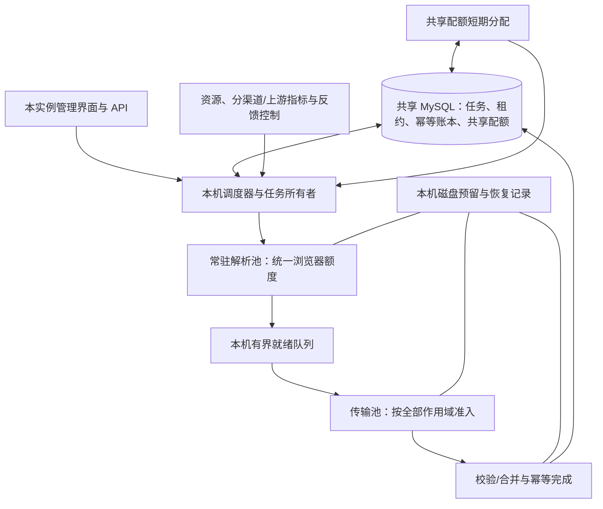

# 多渠道、多上游下载调度设计

本文记录优化前代码与 2026-10-29 现场分析形成的完整设计，其中包含尚未实现的后续能力。已落地范围、配置方法与实际限制以 [下载调度的使用与实现](download-scheduler.md) 为准；本文的基线表格与参数提案不代表最终运行配置。目标是在画质与账本语义相同的前提下，提高单位时间内通过校验的唯一文件字节及完成任务数。

## 1. 已知事实与能力边界

| 代码或证据 | 当前行为 | 设计影响 |
|---|---|---|
| `web_worker.py:attempt()` 与外层下载器循环 | 下载方式按顺序回退，第一个成功后结束；不是多渠道负载均衡 | 增加可选 `balanced` 模式，保留 `ordered_fallback` |
| `webapp/bergung.py` | 站点/API 常量固定；浏览器访问视频、容器、编码、本地处理设置，再等待验证、提交并捕获 POST 响应 | Bergung 类渠道通过配置化适配器接入，不能只改渠道显示名 |
| `bergung.result_info()` | 接受 `redirect`/`tunnel`，返回媒体 URL、格式与 Referer | 解析服务、隧道服务和最终媒体源可能是不同带宽资源 |
| `yt5s_browser.BrowserSession` | 浏览器属于工作进程；空闲 5 秒退出；签名/容量变化、20 次使用或 300 秒生命周期触发回收 | 不能假定已有跨任务进程的共享浏览器会话池 |
| `browser_pool.py` | 跨进程锁限制所有常驻浏览器，等待最长 600 秒 | 保留常驻容量约束，改成有准入的解析池，减少占租约等待 |
| `throughput.py` | 已分离传输名额；每 5 秒采样，至少 30 秒调节；总工作进程至多 96 | 可作为兼容执行器和控制框架，不是完整的分上游调度器 |
| `throughput.py` | 浏览器上限含 `floor(cpu_cores / 2)`；接收速率含非有效文件流量，CPU 调节仍受单次压力样本影响 | 改为启动估计加持续压力反馈；禁止只提高页面配置就宣称实现 3 浏览器探索 |
| `downloader.py` | `concurrent_fragment_downloads` 与 10 MiB `http_chunk_size` | 前者用于分段协议；后者不表示普通 MP4 多连接并行 |
| `web_worker.py` | 多下载器回退或策略变化时禁用续传，避免不同编码混写 | 新续传必须先证明相同媒体对象，不能直接删除保护 |
| `fleet.py`、`store.py` | hybrid 一体化实例，共享 MySQL 任务租约；实例配置/状态独立；领取锁涉及共享 `fleet_budget` 行；0 表示仅按实例额度 | 本机快速调度与共享配额协调分层，不重新拆成强制中心管理/纯下载角色 |
| `database.py` | 每进程 SQLAlchemy Engine；默认 pool_size=5、overflow=5，pool_size 实际至少 2；checkout 超时 15 秒 | 池大小不是下载任务数；需要按所有进程、实例计算连接预算 |
| `disk_budget.py` 与现有收据 | WAL、原子磁盘预留、回收及完成记录恢复 | 保留空间约束、幂等记账及崩溃恢复 |

此前记录中的 J4125 四核、约 7.36 GiB 内存、有其他容器负载，只是该次测量的硬件基线。网卡协商 1 Gbps 不等于公网套餐带宽；历史提过的 300 Mbps 尚未独立核实。旧采样实际传输通常只有 1–3 个，浏览器等待较多；多渠道是否能提供独立增量带宽仍待验证。

**未确认能力：** 新渠道之间是否共享后台/账号配额，Bergung 媒体是否支持可靠 Range、对象长度及强校验标识，签名地址有效期和出口绑定规则，浏览器是否能脱离页面用 HTTP 轮询，以及媒体 HTTP 连接是否能被当前 yt-dlp 跨任务复用。上述能力全部按适配器探测结果启用，默认不承诺存在。没有证据证明同一视频由不同渠道输出的文件逐字节一致。

## 2. 目标、资源模型与渠道身份

区分以下概念：

- `channel_id`：用户可配置的下载入口与解析机制，例如 `bergung_a`、`bergung_b`。
- `resolver_group`：共享解析 API/验证/转换容量的资源；与文件传输带宽组可以不同。
- `upstream_group`：实际共享媒体带宽的后台、隧道或源站资源。不同渠道可能属于同组，一个渠道也可能返回多个不同上游。
- `quota_group`：共享账号、套餐、请求速率、并发连接或流量总额的资源。流量额度是会消耗的计数，不应建模成可自动恢复的带宽桶。
- `egress_group`：真实共享带宽/连接限制的代理、出口或线路。不同节点名称不一定代表独立出口。
- `instance`：一台 hybrid 服务实例及其可用 CPU、内存、磁盘、网卡、DB 预算。

这些资源是叠加约束，未必形成一棵树。一条传输的作用域集合例如：

```text
{instance:i1, transfer-upstream:u2, account:a1, egress:e1}
```

它必须同时满足每个作用域的活动请求/流上限、速率桶及配额；HTTP/2 的流数与 TCP 连接数分开统计。分片、音视频双流、缩略图等实际请求也要计入相应预算。各作用域观测到的同一份流量不能相加后当成总吞吐。

如果 a/b 两个渠道共用 u1，c 使用 u2，则 a+b 共享 u1 的总额度，c 可利用 u2 的增量带宽。只有 a/b 名称、域名或 IP 不同，不能推出它们独立；同 CDN/IP 也不能单独证明共享限额。

映射优先使用运营配置或供应商明确的信息，并保存证据、置信度、版本与更新时间。解析前使用保守的候选资源组；解析后依据重定向链、最终媒体 host、隧道服务、账号和出口重新绑定。改变绑定后必须重新做准入，不能继续使用旧上游的许可。签名参数和 Cookie 不参与明文统计标签。

未知组从低并发探索。只在本机/出口尚有余量时，对相似文件分别做单组与双组同时传输试验：比较 A+B 总有效速率是否稳定增加及 A/B 是否明显互相挤占，重复多个窗口。吞吐相关性只作为共享瓶颈的线索，不能一次试验就自动断定独立。确认共享后合并预算；自动拆组需更充分证据或人工确认。

粗略的吞吐约束是：

```text
R_good <= min(可持续可用下行, 磁盘可持续有效处理率,
              CPU/TLS/校验的可持续处理率, 解析供给能支撑的字节率,
              满足上游/账号/出口重叠约束时可实现的总速率)
```

优先级目标为质量/一致性与资源约束、有效完成吞吐、较低重传与资源成本。CPU 或 TCP 连接占满本身不是优化目标。

## 3. 一体化实例内的架构



每台实例内一个任务所有者管理已有任务租约、心跳、停止和执行代号；解析和传输执行器经本地 IPC 报告结果。当前阶段仍可由每任务工作进程持有租约并向解析池发送请求，逐步迁移，不能同时存在两个能完成同一任务的所有者。

业务任务继续只有原先的 queued/running/终态语义；新增本地阶段：

```text
QUEUED -> RESOLVING -> READY -> TRANSFERRING -> VERIFYING -> COMMITTED
                     ↘ 失效/错误 -> BACKOFF -> 重新解析或安全续传
```

领取只覆盖已获准的解析工作和有限缓冲。总在途任务（解析、READY、传输、校验）都计入现有实例及正数集群任务额度；空闲网站名额不是提前领取大量任务的理由。

就绪队列保存短期地址、必要 headers、到期时间、原出口、媒体身份和租约代号，默认仅在本机内存。已知有效期时按到期时间调度；未知时优先即时使用、保守限制等待，发生过期后重新解析。跨服务器不派发本机地址或假设其他服务器可续用它。持久化恢复清单默认只保存已验证的对象身份/分片位图；确需保存凭证时仅限本实例受限权限、到期清理的状态文件。

## 4. 关键数据结构

```python
ChannelSpec = {
    'channel_id': str, 'adapter': str,
    'site_url': str, 'api_url': str,
    'resolver_group': str, 'candidate_upstream_groups': list[str],
    'quota_groups': list[str], 'allowed_egress_groups': list[str],
    'quality_policy': dict, 'capability_version': int,
}

PreparedMedia = {
    'task_id': str, 'execution_epoch': int, 'owner_boot_id': str,
    'channel_id': str, 'scope_ids': list[str], 'egress_id': str,
    'url': str, 'headers': dict, 'expires_at': float | None,
    'length': int | None, 'identity': object | None,
    'range_capability': 'unknown|verified|unsupported',
    'quality_observed': dict, 'resume_manifest': object | None,
}

ScopeState = {
    'scope_id': str, 'sharing': 'local|cluster',
    'stream_limit': int, 'resolver_limit': int,
    'rate_bytes_per_second': float | None,
    'request_rate': float | None, 'cooldown_until': float,
    'active_streams': int, 'reserved_rate': float,
    'lease_epoch': int, 'lease_deadline': float,
    'window_stats': object, 'last_trial': object | None,
}

RouteStats = {
    'channel_id': str, 'upstream_group': str, 'egress_group': str,
    'resolve_success_ewma': float, 'resolve_p50': float, 'resolve_p95': float,
    'browser_busy_seconds': float, 'network_payload_bytes': int,
    'distinct_range_bytes': int, 'verified_unique_bytes': int,
    'transfer_rate_ewma': float, 'status_counts': dict,
    'expired_links': int, 'last_evidence_time': float,
}
```

适配器至少暴露 `resolve(task, browser_session)`、`classify_error(error, phase)`、`identify_scopes(result, redirect_chain)`，可选 `probe_range`、`refresh_same_object`、`poll_conversion`。声明能力需版本化，实际响应可随时使能力降级。

## 5. 渠道选择、任务分配和供给控制

### 5.1 分组调度

调度单位首先是满足所有作用域约束的“上游组 × 出口”，组内才选择渠道。别名渠道不因数量多而获得更多总份额。不同视频分配给不同渠道；默认同一视频同时只进行一条解析/传输执行链，避免重复转换和完整下载竞争。

保留两个模式：`ordered_fallback` 使用原顺序；`balanced` 在用户启用、符合质量要求的渠道中分流，失败后再选择其他合适渠道。自动模式不引入用户未启用渠道，也不把 `best` 当成各渠道完全相同的画质。不同编码/容器可满足同一交付策略，但只有逐字节一致才可续传或拼接。

解析阶段的质量字段可能只是上游声明，不能当作已验证事实；最终由 FFprobe 等检查实际分辨率、帧率及音视频完整性，满足交付策略后才计成功。适配器无法提供可靠的最高质量语义时，应明确标记未知，由用户的质量策略决定是否允许参与。

上游组采用加权 deficit round robin；权重按近期有效容量、成功率与解析成本更新，按估计字节计费，估计未知时用同类文件中位数，完成后修正。任务年龄提供提升，避免只下载小视频和大任务饿死。组内渠道按预计完成时间选择：

```text
ETC = 等待解析额度 + 预计解析耗时
    + 等待传输额度 + 预计文件字节 / 保守传输速率
    + 失败重试的预期成本
```

估计结合成功率和 P95 风险；数据过期后降低信任。5% 左右的可用解析机会留给未知或长期没测的健康候选，探索本身仍必须满足额度和冷却限制。小机器只有两个浏览器时不保证每个渠道常驻一个浏览器，而是时间分配探索机会。

### 5.2 供给和背压

先按实际上游逐步探索任务级并行，建立吞吐随并发变化的曲线：1、2、3……。只有新增并发有收益时才增加该组的流额度。

解析能力的粗略估计：

```text
lambda_ready ≈ 解析并发 × 解析成功率 / 平均浏览器占用秒数
R_supply ≈ lambda_ready × 同类视频平均文件字节
```

它是稳定负载估计，不是精确公式。若解析供给只支撑 10 MB/s，增加传输额度不会自动获得 30 MB/s。

初始就绪队列高水位 2–4 个/实例，总 owned 任务还受独立上限约束。随后按缺料率、解析耗时和地址 TTL 调整，不能随着渠道数线性扩大。就绪积压或校验/磁盘积压时停止新的解析；长期没准备出链接且所有渠道均冷却时不继续领取。

### 5.3 浏览器复用

解析池常驻少量浏览器，按账号/站点安全边界、出口与配置版本隔离会话；固定出口会话服务多个连续任务，空闲且资源紧张时回收。增加渠道不会自动增加一个常驻浏览器。常驻、忙碌、验证等待页面数均有上限，空闲浏览器同样计入内存和容量预算。

Bergung 首次建立会话时确认设置；后续仅在配置版本变化或页面验证发现设置丢失时重新设置，不能未经检查就假设设置永远有效。可试验更轻的导航等待条件，但必须保证页面/验证组件已可用。网站兼容性由适配器测试覆盖。

如渠道允许提交后离开页面并用轻量 HTTP 轮询，则释放浏览器执行后续解析；当前 Bergung 代码没有证明存在这样的异步 job API。其 `localProcessing` 明确设置为 disabled，不应把网页解析等同于本机视频转码。

## 6. 多维准入与连接复用

准入包括：本实例文件传输数、全实例请求/流数、各上游请求/流数、账号额度、出口额度、FD 余量、磁盘空间/写入余量、可用内存，以及共享配额分配。

本地协调器采用统一顺序且全成或全退的 `try_acquire_bundle()`：缺任一项立即撤回临时预留，不持有部分网络许可等待其他许可，不在数据库事务中等待浏览器/HTTP/磁盘。降低额度只停止新准入，旧连接正常收敛，紧急空间不足或租约丢失才中断。

连接池按 `(scheme, host, proxy/egress, credential context)` 隔离，HTTP Keep-Alive/TLS 会话复用只在兼容范围内进行。不同 host、出口、认证状态不混用连接。HTTP/2 必须确认媒体端点、客户端、代理链支持，流数量仍受预算限制。

现有 yt-dlp 对象每次 attempt 创建，不能宣称已经具备跨任务连接复用。第一阶段保持 yt-dlp 传输与校验能力，通过适配器包装请求准入；若无法拦截实际每条请求，则先用单媒体流和保守辅助请求预算，不能把“文件并发上限”宣称为精确 TCP 上限。后续可添加本机长驻 HTTP 传输执行器，但必须保持流式写盘、headers、代理绑定、超时、媒体校验与收据协议。

媒体连接/流、浏览器连接、控制请求和管理 API 分别预留预算。FD 接近预算阈值停止新增，不能等到 EMFILE。缓存连接设置总数、单 origin 数量、空闲超时；不能每解析一个地址就永远保留一个新连接池。

## 7. 动态测速与自适应控制

区分三个时间尺度：

1. 每秒更新本地计数，5 秒聚合资源/网络/队列快照。
2. 60–120 秒进行一次单维度并发试验，窗口内工作量不足则延长，不强行下结论。
3. 5–15 分钟评估成功任务/字节和长期失败率，验证短期决策是否改善有效完成。

短期使用去重后的媒体载荷/Range 字节及活跃连接速率，作为尚未校验数据的暂定信号；最终奖励以成功文件唯一字节、重试浪费和完成任务率校正。单个大文件完成前不能把其短窗口零成功字节误判为零传输。网卡 RX 只用于物理余量判断，不直接用于渠道排名。

每次只改变一个阶段/上游参数，并记录试验前负载、准备供给、出口、质量和文件大小档位：

| 观测 | 动作 |
|---|---|
| READY 缺料、解析额度忙、CPU/内存持续有余量、无上游限流 | 解析总并发 +1，或把解析机会移给更高产出的渠道 |
| READY 缺料，但验证/429/转换等待占主导 | 冷却/分流/复用会话，不能因缺料无限加浏览器 |
| READY 有库存，传输额度持续繁忙，本机/出口有余量 | 选一个可能有增量容量的上游，其流额度 +1 |
| 同组多渠道共同增加并发，但总有效速率不升 | 回退额度，合并/复查共享带宽组，冻结探索 2–5 分钟 |
| 持续 CPU 压力且浏览器占主导 | 先降低新解析准入，保护管理和心跳；不要无差别削减低 CPU 的文件传输 |
| 磁盘写延迟、队列和 PSI 同时升高 | 降低传输/分片和校验并发，停止预取；必要时限制写入速率 |
| FD、代理连接、HTTP 429、重传/RTT 明显恶化 | 在对应作用域乘法减小额度，约乘 0.7，并退避 |
| 已接近经过验证的可持续线路能力 | 停止增加连接，寻找更低开销的配置 |

增长使用 +1，回退可用 0.7–0.8 倍，只有提升超过约 5% 且重复窗口支持时保留；5% 是初始灵敏度参数，不是承诺测量精度。资源告警看持续窗口和 PSI/内存事件，浏览器启动的短暂 CPU 峰值不应直接让传输容量连续塌缩。

速率限制使用作用域令牌桶，初始突发容量约 1–2 秒。API 请求速率和媒体字节速率分开。并发闸门必须同时存在，限速桶本身不限制慢连接数量。TCP 拥塞控制由内核/对端负责，应用只做有益并发、平滑新连接和退避；不能把接收端改一个 BBR 参数当作必然提速方案。

## 8. 任务并行、分片与断点续传

优先不同视频的任务级并行：尤其是格式身份未知、普通 MP4 不支持 Range、同一上游总限速、解析昂贵或磁盘资源紧张时。同组上游总带宽已饱和时，增加同文件分片没有增量收益。

同文件 Range 并行只在大文件、单连接受限、上游仍有容量、且本机有余量时探索。必须先发小量真实 Range GET，检查 `206`、准确 `Content-Range` 和总长度、返回长度、身份编码、稳定对象标识与随机区间一致性；HEAD 或 `Accept-Ranges` 单独不足以通过。

初始每文件 1 条，确认后试 2 条，通常不超过 4 条；分片建议 8–32 MiB 起步，按 RTT、速度及重试成本调整。视频/音频、Range、HLS/DASH 片段都共享全局和各作用域预算，不能出现任务数 × 分片数的无约束乘法。HLS/DASH 由协议适配器按原 manifest 合并，不与任意 MP4 字节片段混用。

恢复清单保存总长度、对象身份、编码/质量、已完成范围与本地校验值；稳定完成块按有界批次落盘和原子更新清单。重新请求使用经过验证的强 validator/不可变对象身份，必要时 `If-Range`；返回 200、长度/身份变化、416 异常或编码变化时停止续写，重新判断对象并按需重启。

**跨渠道拼接默认关闭。** 只有可信的全文件哈希/不可变媒体对象身份等证据证明逐字节相同，且每个端点可靠支持 Range，才可作为镜像源使用。相同视频 ID、分辨率、文件名、Content-Length、弱 ETag，甚至少数抽样字节相同，都不足以单独证明整文件相同。跨独立服务器的强 ETag 字符串相同也未必具有共同可信语义。无法证明时从另一渠道完整重下，不能保留旧渠道片段硬拼。

## 9. 异常、限流与重试

| 错误 | 分类与处理 |
|---|---|
| DNS/TCP/TLS/代理故障 | 按发生阶段定位 endpoint/出口；连续故障短期冷却，半开仅少量探测；不直接认定所有渠道后台故障 |
| 429 / 明确配额耗尽 | 尊重 Retry-After（秒或 HTTP-date）；更新真正共享的账号/上游组，各渠道共同退避；配额耗尽按重置时间处理 |
| 5xx / 暂时不可用 | 有上限的指数退避和 full jitter，降低该作用域准入 |
| 403 / 验证 / Cookie | 区分会话、出口、签名过期；允许一次有预算的刷新，需人工验证时标记相应渠道等待，避免放大浏览器数量 |
| 媒体 URL 404/410 | 可先认为地址失效并有限重新解析；不能等同原视频永久不存在 |
| 明确原视频删除/地域或内容不可用 | 按可靠证据与策略决定终止或其他渠道尝试；不处罚全上游 |
| Range/格式/校验不一致 | 停止使用已有分片，降级单连接或换渠道重下，保留诊断 |
| 磁盘不足/DB 饱和/许可等待 | 资源背压，保留任务意愿，不耗视频业务重试次数；资源等待也要有次数/时间边界及告警 |
| 租约丢失/停止/执行代号过时 | 立即停止本地执行，旧回调禁止写终态或覆盖成品 |

短重试默认 base=2 秒、cap=120 秒，`delay=max(Retry-After 剩余时间, uniform(0, min(cap, base*2**k)))`。短时释放网络/浏览器许可再等待；长冷却释放任务回队列，而非占住一个浏览器 sleep。

业务尝试默认 3 次，每次最多 2–3 个渠道候选；传输内部短重试 1–2 次，所有层共用一次执行的请求/时间/重复字节预算。保留重试流量占比上限（起步 10%），避免 yt-dlp、分片、渠道回退、任务重试各自乘法放大。不能把重试浪费计入有效吞吐。

## 10. CPU、内存、磁盘与管理服务保护

资源发现综合 affinity/cpuset、cgroup CPU/内存及宿主机剩余压力，不能仅按物理核数或宿主机总内存分配。给 Web 管理、数据库心跳、磁盘维护和系统进程留资源。浏览器使用实测 P95 RSS 定容量，替代永远假设每个只占 384 MiB。

持续 CPU 超过约 85–90% 且管理延迟/压力升高时收敛，启动瞬时尖峰除外；可用内存低于约 15% 或内存 PSI/oom 事件发生时停止扩张。阈值为起点，需按其他容器负载调节。

磁盘使用现有 DiskBudget 的原子预留、WAL、监控、收据与恢复。流式写入，限制缓冲总字节；未知大小逐步扩大预留。音视频合并、分片临时文件、原始文件及成品要计入峰值空间。避免先写分片、拼成第二份、再全文件复制的多重 I/O；可靠实现可使用有界区间写入与完成位图，但要验证崩溃恢复。

校验/合并起步并发 1，不允许每个下载都无界启动 FFmpeg。下载、校验、目录扫描、日志、导入以及若存在的媒体外传共同消耗磁盘；按实际磁盘设备识别共享关系。全双工网络的上行和下行分别计量，是否共享套餐/代理瓶颈由证据决定，不能简单把所有 TX 从 RX 上限扣除。

不在生产磁盘直接跑破坏性基准；由实际大文件持续写入、dirty/writeback、设备 await/队列、IO PSI 推断可持续余量。短期页缓存写入速度不能当成 SSD 持续速度。下载目录、临时目录、Docker volume 若共用一个物理盘，必须共用预算。

## 11. 数据库连接池与任务并发

连接池用于短事务，不应在网页验证、文件下载或退避期间持有连接。当前 `TaskStore.connect()` 是 `engine.begin()`，需要确保所有上下文及时退出。每个媒体分片不创建 Engine，也不逐块写 SQL。

当前默认每进程池上限为 5+5=10，按需建立，不是进程启动就立即开 10 条。13 个数据库进程的理论池上限可到 130，不代表只允许或需要 10 个下载任务；多个实例还会相加。

```text
DB_theoretical_cap = sum_over_all_processes_and_engines(pool_size + overflow)
DB_budget = max_connections - 其他应用使用预算 - 管理/恢复预留
```

应让理论上限或明确的连接准入上限不超过 DB_budget，并监控实际峰值、checkout 等待和事务耗时。当前代码把 pool_size 至少设为 2，设置 1 不会得到一连接池；严格模式如需 1 应修改该行为并验证心跳与进度线程不互相阻塞。

现有多工作进程架构可先试：主 Web/调度进程 pool=5、overflow=2；下载工作进程 pool=2、overflow=0，分别通过子进程环境设置。若有 12 个工作进程，理论约 7+12*2=31，另加维护、其他实例和其他 Engine。不能把整实例环境直接都设为小池后假定管理端并发仍足够。

目标架构中浏览器/媒体执行器不直接访问业务 DB，心跳与进度通过实例所有者的专用通道写入；减少进程级闲置连接。进度 3–5 秒合并一次，状态转换/完成立即持久化，心跳约 10 秒优先处理，租约仍按实际期限守护。合并心跳是逐任务条件更新，不可无条件续租所有旧任务。短窗口控制指标留本地内存，按 5–15 秒汇总写入。

连接池耗尽时先减少领取和非关键进度/UI统计负载，保留心跳/停止操作的额度；一个共享池没有天然心跳优先级，需 DB 访问并发闸门或单独预算，新增心跳池也计入总预算。不能靠不断加 overflow 修复泄漏或锁等待。

MySQL 5.7 的 fleet_budget 行锁与池大小是不同问题。先缩短锁内事务、复用统计、限制预取和领取频率；后续可引入小批次实例任务额度租约，再另行验证 MySQL 8.4/SKIP LOCKED。不得直接删除原全局锁却保留依赖它的领取一致性逻辑。

## 12. 单实例与多实例的范围

| 资源/状态 | 单实例 | 多实例 |
|---|---|---|
| CPU/内存/磁盘/FD、浏览器和连接池 | 本机协调 | 各实例独立；同宿主机共享资源需识别宿主机层配额 |
| 就绪 URL、Cookie、浏览器配置、临时文件、Range 位图 | 独立状态目录 | 不挂载共享状态卷，不跨实例传递默认可用假设 |
| 任务归属与完成账本 | 原租约和幂等记录 | 共享任务库协调，继续遵循所选任务、目标实例与停止边界 |
| 不共享的上游/出口额度 | 本地 | 各自独立探索 |
| 跨服务器共享上游、账号或出口额度 | 本地闸门即可 | 全实例使用一致 scope_id，由共享配额分配约束总和 |

不需要新增一个强制独立管理服务。所有节点保持 hybrid，任意管理界面可展示共享遥测；本机调度决策由本实例执行。

建议新增共享表：

```text
resource_scopes(scope_id PK, limit_config, cooldown_until, version)
scope_allocations(scope_id, instance_id, boot_id, allocation_epoch,
                  stream_slots, resolve_slots, rate_share, lease_until)
scope_observations(scope_id, instance_id, window_end, compact_metrics)
```

共享配额协调器在短事务中按 scope_id 固定顺序锁行，保证有效分配 slots/rate_share 之和不超过组上限。根据各实例真实需求和边际吞吐分配，保留探索份额，避免多台机器同时独立 +1 把共享上游压垮。请求速率令牌若跨实例共享，应分配小量、短期令牌或实施原子桶，不能每个实例各拿完整桶；流量总额需要可核对的扣减账本。

起步共享额度租约约 60 秒、10–15 秒续租，本地看门狗提前留安全余量停止新增并终止到期传输。额度不足时先归还所有临时本地许可，不带着本机许可等待远端事务。重启使用 boot_id/epoch 拒绝旧分配。短期网络断开不得自行扩容共享额度，控制面失联按保守模式运行至有效分配边界。

租约过期不等于远端连接已物理关闭。回收前要给实际连接退出留宽限；仅靠数据库 fencing 能保护任务提交，不能在任意进程冻结/网络分区下保证远端物理连接零超额。需要绝对连接/速率硬上限时，由共同出口网关执行。此限制必须写入运维语义。

若未来各服务器使用完全独立业务数据库，则现有 Fleet 不能协调它们共享的外部限额；需要共享配额接口或预分配静态额度。不能通过共享各实例 `.cache/web` 来补这个能力。

## 13. 调度伪代码

以下函数为待实现接口。网络和数据库操作均在锁/事务外异步完成；各回调携带任务执行代号。

```python
async def scheduler(instance):
    start_priority_heartbeat_and_stop_watchdog()
    while instance.running:
        events = collect_local_events()
        for event in events:
            if not current_execution(event.task_id, event.epoch):
                discard_stale_result(event)
                continue
            if event.kind == 'resolved':
                release_resolve_permit(event)
                media = identify_actual_scopes_and_quality(event.media)
                if acceptable(media):
                    ready_queue.put_bounded(media)  # 容量已在解析前预留
                else:
                    release_unused_ready_and_disk_reservations(event)
                    retry_or_finish_by_policy(event.task, media.reason)
            elif event.kind == 'transfer_complete':
                release_all_network_permits(event)
                verify_queue.put_reserved(event.file)
            elif event.kind == 'verified':
                commit_with_existing_receipt_protocol_and_epoch(event)
                release_task_and_disk_reservations(event)
            elif event.kind == 'failed':
                release_execution_permits_once(event)
                classify_scope_update_breaker_and_schedule_retry(event)

        metrics = aggregate_5s_if_due()
        if metrics:
            update_health_and_shared_demand(metrics)
            adjust_one_bottleneck_dimension_if_trial_due(metrics)
        flush_batched_progress_without_starving_heartbeats()

        # READY 优先，按到期风险、任务年龄和分组公平性挑选。
        for media in ready_queue.fair_candidates():
            if expires_before_safe_start(media):
                invalidate_and_requeue_resolution(media)
                continue
            permit = try_acquire_bundle(
                local_resource_budget, media.scope_ids,
                valid_cluster_allocations, actual_stream_cost(media))
            if permit:
                ready_queue.remove(media)
                dispatch_streaming_transfer(media, permit, epoch=media.execution_epoch)

        # 领取前已保留解析、READY 和所需磁盘/owned 额度。
        while has_bounded_supply_demand() and not pressured_or_db_blocked():
            route = choose_group_then_channel_by_DRR_ETC_and_exploration()
            if route is None:
                break
            reservation = try_reserve_resolve_ready_disk_and_scope_bundle(route)
            if reservation is None:
                mark_route_temporarily_unavailable_this_tick(route)
                continue
            try:
                task = await claim_short_transaction_with_fencing(route.policy)
            except Exception:
                reservation.release()
                signal_database_backpressure()
                break
            if task is None:
                reservation.release()
                break
            dispatch_resolve(task, route, reservation)

        dispatch_bounded_verification()
        await next_event_or_short_tick()
```

`dispatch_streaming_transfer` 的所有新增请求，包括能力探测、重定向、分片和重试，必须重新检查对象身份、剩余配额及请求许可。扩大分片数时立即尝试许可，失败就继续原有流数，不持有一个分片许可阻塞等待另一个。

```python
def adapt(metrics, current):
    if persistent_disk_pressure(metrics):
        return reduce_transfer_and_segment_admission(current)
    if persistent_memory_or_browser_cpu_pressure(metrics):
        return reduce_resolver_admission_first(current)
    if shared_scope_throttled(metrics):
        return multiplicative_decrease_and_retry_after(affected_scope(metrics))
    if trial_pending(current):
        if trial_has_enough_comparable_work(metrics):
            return keep_if_useful_gain_else_revert_and_cooldown(current)
        return current
    if ready_starved(metrics) and resolvers_busy_with_resource_headroom(metrics):
        return trial_one_more_resolver_or_better_channel(current)
    if ready_available(metrics) and transfers_busy_with_resource_headroom(metrics):
        return trial_one_more_stream_on_unsaturated_scope(current)
    return current
```

调度中必须保留实际 DB 租约守护。`current_execution()` 应同时验证当前本地执行代号、boot_id，以及最近一次成功数据库续租确认的有效期限；无需为每个本地事件查询数据库。无法在期限内续租则停止执行；最终提交仍要在数据库中条件验证任务、owner、boot_id/执行 epoch。旧执行仅能清理自己的暂存目录，不能覆盖新代成品。进程启动失败、IPC 断开、取消和超时也必须走同一套幂等许可回收路径。

## 14. 初始参数建议

以下为 J4125 级机器试验起点，未做新压测，不能直接当最佳值推广到所有服务器。

| 参数 | 建议起点 | 调整条件 |
|---|---|---|
| 总浏览器并发 | 2，允许自动试 3，稳定后才试 4 | 实测 P95 RSS、持续 CPU 与管理延迟；修改现有 CPU/2 硬上限 |
| 同一新渠道解析 | 1 | 全机浏览器池共享；渠道数不乘浏览器数 |
| 单一未知媒体上游传输 | 1，探索到 2 | 连续窗口有有效增量才继续 +1 |
| 全实例文件传输 | 初始 4，首轮上限 8 | 供给充足再试 12/16；此为执行器上限，不预分配同样数量 DB 连接 |
| READY 队列 | 2–4 / 实例 | 受 TTL、owned 与空间约束 |
| 校验/合并 | 1 | 磁盘/CPU 有余量才扩大 |
| 普通媒体分片 | 默认 1，验证后试 2，通常最多 4 | 必须通过 Range 和对象身份验证 |
| HLS/DASH 片段 | 初始 1–2 / 文件 | 仍计入所有作用域流额度 |
| 指标采样 / 试验 | 5 秒 / 60–120 秒 | 工作量不足延长窗口 |
| API 请求令牌 | 未知渠道先不超过约 1 次提交/秒，低突发 | 上游明确规则优先；轮询和页面内请求需独立约束 |
| 探索份额 | 约 5% 准备机会 | 仅健康、有预算渠道 |
| 网络超时 | 连接约 10 秒，读取无进展约 20–30 秒 | 按渠道 P95 与真实最小进展调节；无进展不等于整文件超时 |
| 页面/验证 | 保留 Bergung 现有阶段上限作基线 | 单独测 P95 后调整，不能统一硬砍成短超时 |
| 网络突发桶 | 1–2 秒额度 | 拥塞与 429 升高则减小 |
| 工作进程 DB 池 | 2 + 0 overflow | 预算全实例/集群总和，监控 checkout 和心跳 |
| 主进程 DB 池 | 5 + 2 overflow | 同时满足 UI、维护与调度，非固定最优值 |

## 15. 接入步骤与验收

1. **补齐观测与渠道注册。** 新增 `channels.py`、`resource_scopes.py`；把 Bergung 站点/API/质量参数移入经过校验的 ChannelSpec。保留现有 Bergung 适配器与执行入口。增加 channel/group/egress、解析耗时、真实传输和限流指标；明确配置 schema，不能让任意 URL 绕过现有媒体地址校验。
2. **先做不同视频分流。** 新增 `scheduler.py`，在 `web_worker.py` 中将首选渠道选择与回退分离，先用当前执行器、单文件单连接；`settings.py` 和管理页增加模式、渠道和组映射，不用强制修改已有有序策略。测一个已知上游的并发曲线，再接入第二个已证实不同后台的渠道。
3. **重构解析池。** 新增 `resolver_pool.py`，修改 `bergung.py`/`yt5s_browser.py` 的会话归属；由任务所有者经 IPC 借用解析能力。保留常驻浏览器容量、出口绑定、停止和磁盘预算。把 READY 队列背压与 `TaskRunner` 对接，先灰度浏览器 2→3。
4. **替换单维控制器。** 扩展 `throughput.py` 和 `proxy_health.py` 为分阶段、分作用域控制；增加持续压力判断、失败分类和试验记录。验证未知/共享组没有因为添加别名而突破额度。
5. **完善传输与恢复。** 新增 `transfer_engine.py` 的连接/请求预算、可靠 Range 探测、manifest 和续传；先实现单端点 Range，再考虑可信镜像。保持 `completed_file`、FFprobe、收据、统计/账本与 DiskBudget 语义。
6. **多实例共享配额。** 通过 `database.py`/migrations 新表、`fleet.py` 的需求与分配接入；第一阶段可静态分配已知共享上游额度，验证后再动态租约分配。数据库结构升级仍由已有初始化机制串行执行，工作进程复用 schema token。所有实例升级完成前，不让旧执行器绕过新共享限额。
7. **逐步减少工作进程 DB 连接。** 心跳/进度收敛到受限写入通道，增加 epoch fencing 与任务恢复测试；之后再评估批量领取、MySQL 8.4 等独立升级。每个阶段独立开关、回退和对照，不同时把所有算法参数改掉。

监控至少包括：

| 维度 | 指标 |
|---|---|
| 最终产出 | 同质量约束下成功唯一文件 bytes/s、任务/小时、任务完成 P50/P95 |
| 网络 | 物理 NIC/容器 RX/TX、去重媒体载荷、重复字节、流数/TCP 数、RTT/重传（可观测时） |
| 供给 | RESOLVING/READY/TRANSFERRING/VERIFYING 数量；有未完成任务时传输缺料时间比 |
| 渠道/组 | 解析成功率、P50/P95、启动首字节、活跃传输速度、并发增量收益、TTL 失效率、429/5xx/验证率 |
| 资源 | cgroup CPU/节流、RSS/可用内存/PSI、FD/连接、磁盘 await/队列/dirty/writeback、空间预留 |
| DB/控制面 | 实际连接、池 checkout P95/P99/超时、事务时长、行锁等待增量、领取时延、心跳期限余量 |
| 一致性 | 校验失败、重复完成/计费、执行代号拒绝、租约超时、重试预算与配额超限 |
| 一体化管理 | 页面/API P95、停止生效时延、导入/统计对调度影响 |

对照试验顺序：Bergung 单渠道基线 → 同渠道任务并发阶梯 → 第二个已确认独立渠道、相同总并发 → 多上游自适应 → 浏览器复用/2→3 → 已验证源的大文件 Range。每组预热后至少 15–30 分钟或足够完成任务数，使用相同视频集合、质量、出口与大小档位，在不同时间段交叉重复，最好至少三个窗口。不得仅挑选某一分钟高峰作结论。

验收看有效吞吐稳定增加，且画质、错误、重传、账本、管理延迟及资源压力满足约束。若只有 RX 增长、成功文件字节不增，判为无收益；若多渠道不能增加带宽，先复查共享上游/出口身份与解析供给，再考虑硬件或独立线路。每轮保留变更参数、资源约束、样本数、试验置信度及回退条件。
