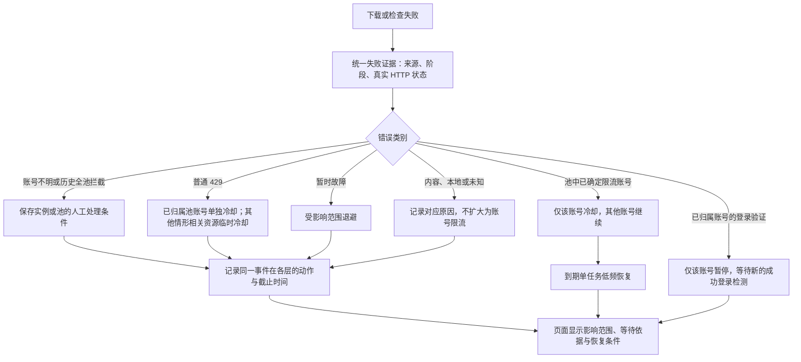

# 下载失败与账号保护

普通下载故障只影响任务重试。账号保护只处理明确限流、符合条件的连续媒体 403，以及登录或验证要求。

| 失败类型 | 任务/渠道处理 | Cookie 处理 |
| --- | --- | --- |
| DNS、网络不可达、超时、断流、TransportError、响应不完整、无数据块 | 按任务尝试次数有限重试；保留任务自身的重试间隔 | 不增加冷却、间隔，不清零恢复观察 |
| HTTP 408 | 任务至少等待 15 秒重试 | 不改变账号状态 |
| HTTP 500 / 502 / 503 / 504 | 单任务至少等待 15 秒；同一渠道 60 秒内有 3 个不同任务报错时，渠道暂停新请求 30 秒 | 不改变账号状态，不冷却共享配额 |
| 明确账号限流、429、符合条件的连续媒体 403 | 保留原账号保护及低频恢复规则 | 仅保护受影响账号 |
| 已归属账号的登录失效、网页验证要求 | 任务绑定原账号等待，仍受任务尝试次数上限约束；等待人工处理时不发送自动探测 | 标记“需人工处理”，跳过该账号，其他账号继续 |
| 内容限制、视频删除、私密、格式不可用 | 按内容失败处理 | 不退避账号 |

源站的 `Retry-After` 仍生效；任务的配置尝试次数、启动间隔、结束后休息和滚动预算也继续生效。

处理账号登录或验证后，在账号管理点击“检测登录”。只有新的成功检测才能解除该账号的人工暂停；旧缓存、检测超时、其他任务的迟到成功、检测期间新出现的验证失败，都不能解除暂停。已有的限流冷却不会因此被清除。同一账号的重复 Cookie 共享暂停状态。

无法归属具体账号的验证异常、非池模式和历史保存的全池人工拦截，保留原有的实例保护及人工恢复流程。本次调整不自动清理过去保存的冷却和慢速间隔。

## 错误证据

每条证据包含事件编号、观察时间、来源、阶段、错误类别、HTTP 状态、证据类型、Retry-After、能否自动重试和脱敏摘要。账号限流是错误类别，不能写成未经观测的 HTTP 429；账号提示可能出现在 HTTP 200 响应内。

HTTP 异常对象的状态与错误文本里的 HTTP 状态分别标记。仅在文本明确写出 HTTP 状态时解析，URL 中的数字不参与判断。异常链遵守 `raise ... from None`，本地资源等待及历史池停止优先识别为本地原因。

## 多层决策

同一次失败在各层共用事件编号及冷却基准时间，截止时间取较晚者，不把冷却秒数相加。不同阶段和渠道仍按各自许可检查；某个解析组冷却不等于所有正在传输的视频必须中止。晚到的成功不能清除尚未结束的冷却，会话也不能因旧任务成功而提前完成观察期。

资源状态各保留最多 8 条决策，页面聚合最近最多 8 个事件。同次事件合并展示各层影响，保留摘要而非 Cookie、响应正文或带签名的完整地址。批量读取多实例诊断时，本地停止和节奏状态按实例过滤，共享资源仍按配置共享。

## 页面和恢复

工作台及实例页的「并发与等待」展示当前限制、影响范围、倒计时、人工恢复条件及最近触发记录；任务详情展示本次已保存的结构化错误证据。离线或过期采样显示为上次记录，倒计时到零只提示等待新状态，不承诺源站恢复。

人工停止状态不会因冷却到期自动解除。已归属账号需要新的成功登录检测才能解除人工暂停，其他账号继续按各自条件执行。无法归属或历史全池拦截需按页面提示停止实例、等待任务结束并检查成员，再手动恢复；实例恢复不会清除池及共享资源限制。

旧版保留下来的池停止标志（包括当时由 HTTP 429 产生的标志）继续要求人工检查；缺少具体响应证据时明确标为历史记录，不自动归类为新的账号限流。

## 验证

`python -m unittest tests.test_download_policy tests.test_download_decisions tests.test_cookie_pool tests.test_youtube_pacing tests.test_youtube_policy tests.test_channel_scheduler tests.test_concurrency_diagnostics tests.test_risk_diagnostics`

场景覆盖真实 HTTP 与账号提示分离、异常链、敏感数据脱敏、跨层事件与截止时间一致、普通 429 到期准入、旧停止重放、迟到成功、实例恢复、多实例隔离及 Node 页面渲染。
