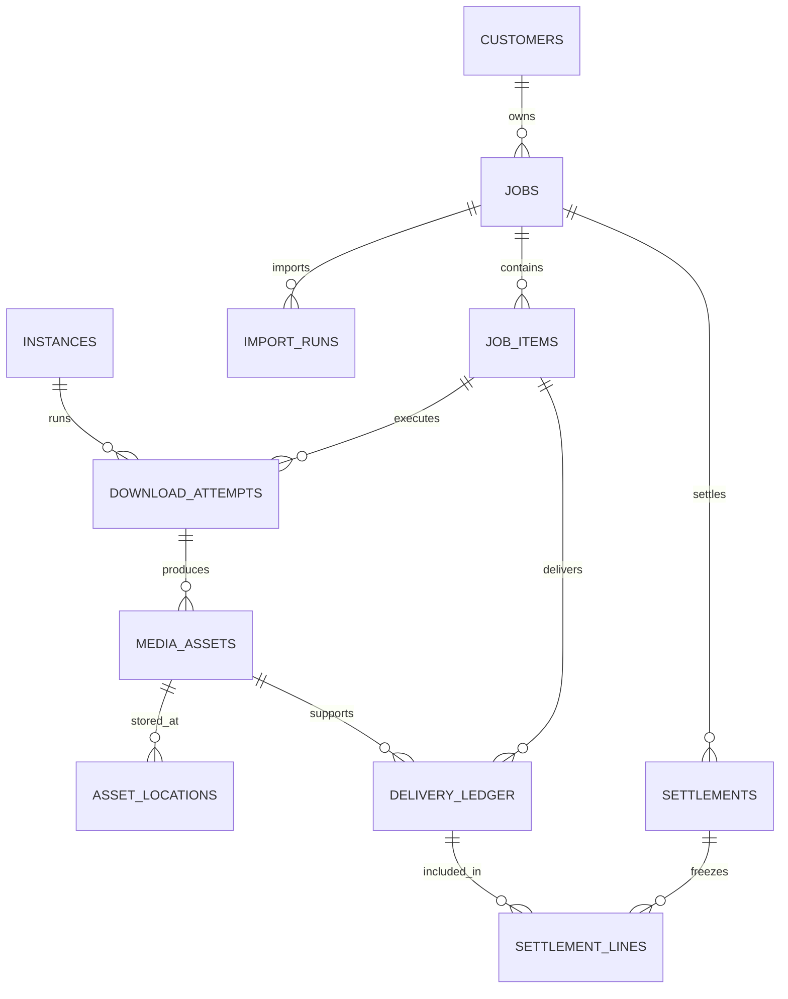

# 项目功能、页面与架构审查

审查日期：2026-10-26。对象为当前工作区代码，包含任务中心与管理下载一体模式。

结论：需要进行一次围绕客户任务的整理。第一优先是统一计费来源与写入规则，随后统一操作入口和状态模型，再拆分执行与存储模型、优化查询和迁移。继续保留 Flask、SQLAlchemy、MySQL 和独立下载进程，适合逐步完成这次改造。

## 1. 审查依据与范围

检查了页面模板、前端状态更新、任务接口、旧清单与会话接口、调度、交付登记、素材索引、数据库声明、初始化升级和 CI 配置。用临时 SQLite 数据库构造客户任务、登记模拟交付，并核对跨接口行为。

复现结果位于 `.cache/validation/architecture-review-evidence.json`，复现脚本为 `.cache/validation/review_architecture.py`。这些结果可以证明业务行为及 SQL 次数；MySQL 实际吞吐、慢查询、执行计划、锁等待和生产数据质量仍需要在独立的目标版本测试库验证。

现有值得保留的基础：数据库事务领取、租约和失效执行隔离、交付幂等、分块导入、游标分页、字节使用 BIGINT、金额通过 Python Decimal 计算、清单删除保留交付账本。重新设计时应把这些能力转化为明确的不变量与验收条件。

## 2. 已确认的问题与改造优先级

P1 表示建议在继续扩展功能前处理；P2 表示随后完成的模型与容量优化；P3 表示有相应需求后再建设。

| 编号 | 优先级 | 当前问题与证据 | 建议 |
|---|---|---|---|
| F01 | P1 | 客户任务和全局会话各自计算金额。模拟交付两个 1 MB 文件，任务单价分别为 100、200 元/GB，任务预计金额合计 0.30 元，旧会话统计合计 0.00 元。 | 客户任务交付账本成为业务计费来源；执行会话保留运行统计，停止编辑商业单价。全局金额从任务账单汇总。 |
| F02 | P1 | 新旧接口的业务约束不同。归档任务通过新接口修改返回 400，通过旧 `/api/statistics/lists/<id>` 返回 200，并能把客户改为空。旧接口把待定单价改为 9 后，新任务仍是 `price_set=false`、金额为空。 | 所有写入口调用同一个任务服务；先封闭绕过路径。旧接口逐步只读，新旧页面对同一实体使用同样的校验、版本和事件。 |
| F03 | P1 | 首页仍显示“新清单需点击开始下载”“启动新清单”，但旧全局启动故意不放行任务中心的新任务。模拟队列有 1 个视频，全局激活后该任务仍未放行，无法领取。 | 新建、导入和任务开始集中到任务中心；全局按钮明确为“恢复系统领取”，不再描述为启动客户清单。 |
| F04 | P1 | 恢复流程不同：旧集群恢复经过异步启动检查，任务中心 `/api/jobs/system/resume` 直接修改暂停标记。任务开始、系统恢复、实例恢复分别实现检查。 | 建立统一的执行控制服务，按命令类型明确检查范围、期望状态、可执行实例和阻塞原因。系统恢复可以只恢复领取，但必须表达这一语义。 |
| F05 | P1 | 开始任务会检查每个在线且启用的实例，任何一次异常都会使启动失败。执行时，业务任务遇到本机 Cookie 或工具异常会暂停整个客户任务。 | 按能力和健康状态选择可运行实例；本机故障先隔离实例或能力，健康实例继续。用户主动暂停才改变任务的运行意愿。无可用实例时显示“等待可用实例”。 |
| F06 | P1 | 管理页面有 CSRF 会话，却没有操作者登录与权限检查；全新浏览器可读取 `/jobs` 和 `/api/jobs`。部署访问码只保护设置页。 | 用于多人或其他电脑可访问的部署时，增加管理登录；至少区分管理员、操作员、只读。节点令牌限定本地资源与执行 RPC，和人员会话分开。 |
| F07 | P2 | 任务列表逐项调用详情；实际一页 20 项执行 141 次 SQL。详情加载配置、运行中视频和导入信息，列表即使不用这些信息也查询。每 5 秒自动刷新放大查询量。 | 独立列表 DTO，批量取计数与摘要，详情按页签加载；先消除 N+1，再做缓存与刷新策略。 |
| F08 | P2 | 领取顺序主要是 `available_at, seq`。临时示例领取顺序为 A、A、A、A、B；大任务持续有可运行条目时，后来的小任务需要等待。 | 按任务轮询或带权公平调度；增加任务优先级与任务并发上限，继续满足全局和实例并发。 |
| F09 | P2 | 一个客户任务分散在 `batches`、`download_lists`、`job_profiles`；`tasks` 同时是视频成员、运行状态和维护队列，重试覆盖当前字段。 | 明确客户、客户任务、视频条目、执行尝试和维护作业的边界，逐步建立规范表。 |
| F10 | P2 | 成品索引按根目录和相对路径定位；交付记录只有任务和文件路径，未直接保存独立的实例/存储位置。条目当前实例会随重试改变。 | 成品、位置、交付三者分开；历史交付保存稳定成品引用，文件位置明确所属实例或对象存储。 |
| F11 | P2 | 清空整单在一个事务内循环更新；归档/停止也逐行处理运行中任务。大清单锁等待与同任务并发追加会互相影响。 | 在短事务中设置操作状态和成员代次，再通过后台作业分块执行，返回操作 ID、进度与结果。保持现有旧导入失效机制。 |
| F12 | P1/P2 | 启动过程检查并修改表结构；CI 调用了当前不存在的 `scripts/verify_pipeline.py`。真实 MySQL 集成依赖外部测试连接，默认 CI 未提供测试库。 | 修复 CI 的验证入口；建立固定版本 MySQL 集成测试。逐步采用版本化迁移，运行账号与迁移账号分离，Web 启动只检查结构版本。 |
| F13 | P1 | 多个管理页面没有编辑版本冲突检查。复现中页面一把单价 1 改为 19，页面二用旧表单修改名称并提交，返回 200，最终单价又变为 1。事务行锁无法识别过期表单。 | 增加实体版本号和条件更新，旧版本写入返回 409 并提供差异。清单失效代次、策略版本和编辑版本分别保存。 |

相关代码入口：`webapp/statistics.py:93,214`，`webapp/lists.py:74`，`webapp/jobs.py:161,272,370,380`，`app.py:134,614,759`，`web_worker.py:470`，`webapp/store.py:614`，`.github/workflows/tests.yml:18`。

F01 是两种商业口径并存引起的实际不一致，不代表发生了重复扣款。当前产品仍是预计费用，没有支付结算流程。应在正式对客结算之前统一来源。

## 3. 页面结构与交互方案

### 3.1 统一导航和应用外壳

推荐主导航：全局总览、任务中心、客户、交付与账单、素材库、实例与环境、系统设置。原执行会话放到运维记录或任务执行详情，历史会话数据保留可查。

`templates/index.html` 和 `templates/jobs.html` 目前是两套页面外壳，导航、品牌、按钮与样式独立。采用共同的基础模板、导航和反馈组件，保留现有原生 JavaScript，按页面与组件拆分模块。避免任务中心跳回旧工作台后丢失上下文。

顶部明确显示两个不同概念：“当前访问节点”和“正在配置的实例”。全局总览和客户任务默认看整个系统；进入实例配置或素材库后才选择目标实例。全局单价、下载策略和本机目录不再放在一个提交表单中。

一体模式成为默认使用方式。页面通过“本机参与下载”开关控制执行能力；纯管理端、纯下载实例和原单机角色放到高级部署兼容选项。独占数据库的单机转换保留明确提示，和“本机既管理又下载”区分。

### 3.2 三个操作范围

| 操作范围 | 可见状态 | 操作 | 作用 |
|---|---|---|---|
| 系统 | 允许领取、停止领取、正在停止、阻塞原因 | 恢复系统领取、完成当前后暂停全部、立即停止全部 | 保留每个客户任务的运行意愿，恢复后只运行已开始的任务 |
| 客户任务 | 草稿、待开始、运行意愿、实际执行、等待原因、已归档 | 开始、完成当前后暂停、立即停止、重试失败 | 只修改当前任务 |
| 实例 | 在线/离线、健康能力、允许领取、停止中 | 启用本机、暂停本机、停止本机、检查环境 | 停止本机执行后，管理页面继续可用 |

应分别保存“用户希望运行”和“当前实际在运行”。一个任务已经开始但暂时没有健康实例，应显示“等待可用实例”，同时保留开始意愿；被系统暂停的任务应显示原因及去向。立即停止先显示“停止中”，实际退出或租约失效后再完成反馈。

### 3.3 任务详情

保留现有五个页签，调整内容：

- 概览：当前清单规模、成功/失败/待处理、运行实例、阻塞原因、处理完成率、累计交付、预计费用和结算状态。明确当前清单与历史累计的不同范围。
- 视频清单：视频状态、实例、尝试次数、失败原因、成品可用性；支持筛选、批量操作和移除恢复。大批量操作显示后台进度。
- 统计与账单：预计账单、交付依据、正式结算快照和调整记录；免费、待定单价和正常计费采用统一状态。
- 执行记录：每次尝试的时间、实例、下载器、失败类型和日志，不再仅显示最近 50 条操作消息。导入记录、用户操作与下载尝试分别筛选，并可分页。
- 任务设置：基本资料、计费规则、任务下载策略和并发。下载器顺序使用和系统模板相同的选择/排序组件，替换手写 `yt_dlp, yt5s, downmp3` 的输入框。

清空与删除要继续保留历史账本，但新增可查询的回收站和恢复入口。删除文件是独立存储操作，先展示受影响任务和可恢复性。补下载已丢失文件、重试失败、再次向客户交付应作为三个不同动作；补下载默认不新增商业交付，新增交付必须明确计费规则。

### 3.4 消除能力说明矛盾

首页在只选 yt-dlp 时显示“视频 / 播放列表链接”，但新建任务走 `video_urls()`，只接受单视频 ID 或链接。应先统一为单视频清单能力；若继续支持播放列表，把展开播放列表做成导入作业，解析出的每个视频分别成为任务条目，显示展开进度和无效项。

修改系统默认策略只影响以后创建的任务，应在该表单直接说明；现有任务调整策略要显示生效范围与版本。实例的 Cookie、代理、磁盘和工具检查属于执行环境，不用系统模板暗示会覆盖客户任务的下载标准。

## 4. 推荐业务与数据库模型

下面是目标逻辑模型，实施时可按阶段扩展现有表，保持原 ID 与历史映射。

| 实体 | 主要字段和约束 | 对应现状 |
|---|---|---|
| `customers` | 稳定客户 ID、名称、联系人及默认计费规则；名称不承担关系主键 | 当前重复保存客户字符串，缺少客户实体 |
| `jobs` | 客户 ID、名称、备注、生命周期、运行意愿、清单代次、编辑版本、配置版本、计费状态、归档/删除时间 | 逐步合并 `batches`、`download_lists` 和 `job_profiles` 的业务职责 |
| `job_items` | 任务 ID、来源平台、规范视频 ID、成员状态、调度状态、可运行时间、当前尝试 ID | 当前 `tasks` 中的业务视频成员；唯一键 `(job_id, source, video_id)` |
| `download_attempts` | 视频条目 ID、尝试号、实例 ID、实际配置版本、租约所有者与代次、开始/完成时间、错误码和结果 | 当前重试覆盖任务字段，只有部分会话归类可追溯；每次领取生成新尝试 |
| `import_runs` | 任务 ID、请求幂等键、来源文件、哈希、原始文件所属存储、代次、断点、明确状态及行数统计 | 现有 `imports` 和 `job_imports` 关系收拢，替换 `finished=-1/0/1` 的隐含状态 |
| `instances` | 稳定身份、启动代次、心跳、管理/执行能力、领取意愿、工具及健康状态 | 现有实例注册可保留，逐渐由能力替代角色分支 |
| `media_assets` / `asset_locations` | 成品 ID、格式、精确字节、校验信息；位置含实例/存储 ID、相对路径和可用状态 | 素材目录索引与正式成品关系分开，避免解析路径字符串推断归属 |
| `delivery_ledger` | 稳定幂等键、任务与条目 ID、成品 ID、交付类型、登记字节、登记时间 | 保留现有账本幂等性，普通交付与测试统一事实结构或统一只读视图 |
| `settlements` / `settlement_lines` | 任务 ID、账期/交付范围、冻结单价与单位、字节、金额、时间和状态；同一正式交付不可重复进入有效结算 | 当前预计费用之外的新能力；更正通过调整记录，不直接改已冻结账单 |
| `job_events` / `maintenance_jobs` | 操作者、事件类型、前后值、关联命令/尝试；导入、同步、清理等维护任务独立执行 | 替换仅自然语言事件和 `tasks.action` 中混用的维护职责 |

客户任务的草稿/归档、视频的执行状态和账单的待定/预计/已结算必须分开。预计账单允许变更价格，正式结算快照冻结当时规则；全局统计按同一份交付和结算依据汇总。

正式模式中，客户任务和视频条目的计数单位也要分开：处理完成 = 已成功处理 + 最终失败；正式交付 = 已登记的交付成品；测试和跳过单列。清空当前清单不能改写历史交付。累计参与次数、尝试次数和当前有效视频数分别展示。

## 5. 当前表结构可先做的优化

1. **金额和时间类型**：现有单价是 `String(32)`，大量时间是映射为 MySQL LONGTEXT 的 `Text`。目标单价用 `DECIMAL(18,6)`，结算金额用合适的 DECIMAL 精度；时间统一 UTC `DATETIME(6)`，展示时转换时区。现有 BIGINT 字节和 Decimal 运算保留。先校验历史字符串后迁移，不直接强制转换。
2. **关联与唯一性**：当前声明 27 张表、没有外键。对客户—任务、任务—条目、结算—明细等核心关系增加关系约束；账本关联采用限制删除。高频运行表和历史兼容表是否加物理外键，结合迁移与清理成本决定，并建立一致性检查。
3. **索引清理**：`ix_tasks_video` 和 `ix_tasks_video_prefix` 是同一字段的重复索引声明；`seq` 的列唯一约束与显式唯一索引、ID 前缀索引和主键也需检查实际库重复情况。先检查真实索引和执行计划，再删冗余项。
4. **按任务查文件**：现有交付/测试表只有会话与序号索引，按任务查文件却经由 `tasks` 关联。短期评估增加 `(task_id, seq)`，并评估任务详情所需的 `(batch_id, action, status, seq)`。新账本直接带任务 ID 后使用 `(job_id, seq)`。以测试库 EXPLAIN 和真实过滤条件决定最终顺序。
5. **冷热字段**：把高频调度字段和长期结果、进度 JSON、错误详情分离；JSON 适合配置与扩展数据，客户、价格、调度状态和关联 ID 用可索引列。追加去重使用规范视频键，不用长 URL 作为主要查重条件。
6. **汇总可校验**：现有增量计数有价值，但要视为查询投影。明确哪些事实表可以重建每个汇总，增加核对/修复工具和差异报告。结算依据来自交付事实与冻结规则，不能来自一个无法追溯的计数值。
7. **分页与摘要**：列表一次取任务资料、一次取批量计数，运行/导入摘要批量聚合；任务详情和最近交付按需加载。全局汇总避免每次在 Python 中逐项扫描全部客户任务。

这些优化不需要一开始就给所有表加 `workspace_id`。当前不同业务系统可以用独立数据库隔离；确实需要一个库内承载互不相关的系统时，再把工作空间纳入所有业务键、查询和权限，不能仅放开模式检查。

## 6. 应用与执行架构

推荐保持模块化单体，并明确进程职责：

- HTTP 层：页面、登录、输入校验、返回结果；按任务、账单、实例、素材划分 Blueprint。
- 业务服务：`JobService`、`ExecutionControlService`、`BillingService`、`InstanceService`、`AssetService`。新旧接口统一进入服务层，权限、状态约束、事件和幂等只实现一次。
- 数据访问：SQLAlchemy 查询与事务封装，明确同一命令的锁顺序；列表查询和详情查询分别设计。
- 节点执行代理：心跳、能力检测、领取、停止与子进程监督，作为独立生命周期运行。每台机器仍可以同时启动 HTTP 与代理，由“参与下载”开关决定是否领取。
- 下载适配器：yt-dlp、yt5s、downmp3 统一输入、阶段事件、成品描述和错误类型；解析失败、凭据失败、工具缺失、空间不足和租约丢失采用明确错误码。

当前 Web 启动即启动调度线程，适用于当前单 Web 进程。未来增加 WSGI 进程、重载或水平扩展管理页面时，应先把代理生命周期独立，避免每个 Web 进程重复注册和监督本机执行器。

MySQL 队列可以继续保留。`fleet_budget`、系统暂停标记、活动会话和汇总行存在共用锁；锁会串行化短事务，并不等于当前已出现性能瓶颈。先做真实 MySQL 并发压测、记录锁等待和连接池等待，再决定批量领取、令牌槽位或任务分片。采用外部消息队列后仍需持久化状态与幂等，宜以明确容量需求为依据。

多个页面使用轮询，优先合并重复读取、设置查询预算、做不可见页暂停和自适应刷新。需要事件通知后，可增加事务 outbox 与有容量保障的推送服务；当前 Waitress 使用有限工作线程，不应直接给每个浏览器添加长期占用线程的 SSE 连接。

事件/日志增加命令 ID、任务 ID、条目 ID、尝试 ID、实例 ID和操作者，记录可诊断的错误码与脱敏原因。以节点健康、任务等待原因、重试率、数据库等待、导入进度作为可观测指标。

## 7. 建议实施顺序与验收

### 第一阶段：统一规则和入口（P1）

- 明确客户任务作为商业单位，确定单价待定/免费/计费、按任务累计与正式结算的口径。
- 新旧写入口统一到任务服务；封闭归档、必填资料、价格状态及审计绕过路径。
- 对任务和计费规则的修改增加版本校验，提示多个管理页面的冲突，保留未保存表单以供比较。
- 全局恢复、任务开始、实例启用按范围统一控制协议；故障限制在正确的实例/能力范围。
- 首页变为总览，主创建入口放在任务中心，统一外壳、状态文案和能力说明。
- 修复 CI 验证入口；为可被其他电脑访问的管理页面建立操作者登录。

验收：新旧页面的任务预计总额一致；归档/已结算限制无法被任何写入口绕过；同一客户任务跨多个实例只登记一次商业交付；一台实例不可用时符合条件的健康实例继续领取；按钮的作用范围明确。

### 第二阶段：执行与数据模型（P2）

- 引入稳定客户、规范任务与视频成员模型；保留原任务/清单 ID 和映射。
- 增加每次执行尝试、配置版本、成品与位置关系。
- 增加结算快照与调整记录；提供删除恢复、补下载和交付核对。
- 优化列表、索引、长事务和公平调度。

验收：任务每次尝试能追溯实例与配置；磁盘文件丢失不改历史费用，但能被识别和补下载；暂停、清空、旧导入和旧执行并发时不产生晚写或重复计费；客户小任务获得调度机会；任务列表 SQL 数量不随每页任务数量线性增加。

### 第三阶段：按实际容量扩展（P3）

- 依据生产规模验证锁、调度吞吐、存储和统计投影。
- 按需求增加共享/对象存储、打包交付、客户报表、任务级资源配额和推送。
- 确有隔离需求后再增加一个库内的多工作空间。

### 迁移原则

采用显式版本化迁移：备份和结构检查 → 新增兼容结构 → 分块回填与历史映射 → 新代码单一业务写入口 → 对比新旧读取与统计 → 切换页面/API → 旧结构进入只读保留。避免新旧模型各自独立记账；必要的兼容写入由同一事务和同一幂等事件驱动。

历史没有可靠客户归属、实例归属或完整账本的数据继续标注“历史未分类”，不根据备注猜测并补造收费。迁移前后对照任务数、各状态条目数、交付字节、测试字节和结算金额；旧快照可回查。

最终数据库迁移设计需要补齐实际 MySQL 版本、各表数据量、典型任务规模、并发节点数、账单结算规则、可接受停机时间和备份恢复方式。代码层面可先完成第一阶段及短期查询优化。
